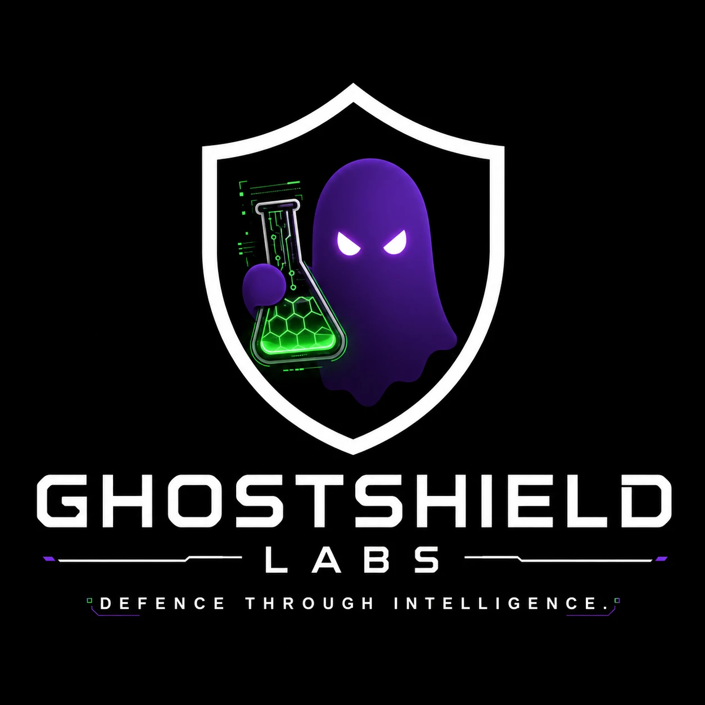

<p align="center">
  
  <br><b>GHOSTSHIELD LABS</b>
</p>

# Orchestra

Your own AI team, running privately on your computer. You ask for something; a **composer** plans it, **workers**
do the jobs, and the results land in your work folder as files and PDFs. Everything runs locally on
[Ollama](https://ollama.com) models picked to fit your PC, with [OpenClaw](https://docs.openclaw.ai) agents. Your
prompts and your work never leave your machine (the only downloads are the models themselves, during setup).

## Download

**[Get the latest installer from Releases](https://github.com/joser14/OrchestraAI/releases/latest)**

| Your computer | File |
|---|---|
| Windows 10 / 11 | `Orchestra-Setup-x.y.z.exe` |
| Mac with Apple silicon (M1 and later) | `Orchestra-x.y.z-arm64.dmg` |
| Mac with an Intel chip | `Orchestra-x.y.z.dmg` |
| Linux | `Orchestra-x.y.z.AppImage` |

Run it, and Orchestra takes it from there: on first start it checks what it needs (Node.js, Ollama, OpenClaw),
offers to install anything missing, scans your hardware and downloads models that fit. On Windows and Linux the
installed app updates itself: new versions download in the background and install the next time you quit. On a Mac,
download new versions from Releases (self-updating needs a signed app).

**First-run warnings.** The installers are not code-signed yet, so Windows may show "Windows protected your PC"
(click *More info* > *Run anyway*) and macOS may say the app is from an unidentified developer (right-click the
app > *Open*).

## What it needs

- **Any PC that can run a small model.** Orchestra sizes the team to the machine: a big graphics card gets big
  models; a laptop or a PC without a graphics card gets small ones (one model for everything, so nothing swaps).
  About 4 GB of free memory is the minimum; 8 GB or more works much better.
- **Disk space** for the models: 3-20 GB depending on the PC (Metrics > Storage shows what is used).
- An internet connection for the first setup (to download the models). After that it works offline.

## Building it yourself

You only need this to change Orchestra. Windows:

```bash
git clone https://github.com/joser14/OrchestraAI.git
cd OrchestraAI/live/app && npm ci
cd plugin && npm ci && npm run build && cd ..
cd desktop && npm ci && cd ../../..
Orchestra.cmd          # run from source
Orchestra.cmd build    # build the Windows installer into installer\
```

Developer notes (what is where, tests, guardrails) are in [live/app/README.md](live/app/README.md).

## Releasing a version

1. Raise the version in `live/app/desktop/package.json`.
2. Tag it and push the tag: `git tag v0.3.0` then `git push origin v0.3.0`.
3. GitHub Actions ([release.yml](.github/workflows/release.yml)) builds the Windows, Mac and Linux installers and
   publishes them as the release for that tag; installed copies update to it on their own.
